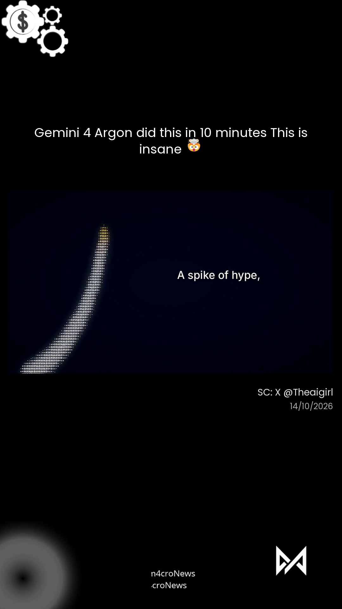

# xnews — X/Twitter video → 9:16 news repost

Konversi video berita dari X/Twitter jadi konten vertikal 9:16 siap upload:
video 16:9 di atas-tengah, judul dari teks tweet, kredit sumber + tanggal
di kiri bawah video, branding channel (logo gear-$, logo M, glow).



## Quick start

### 1. Install semua requirement (otomatis)

```bash
python skills/xnews/scripts/setup.py
```

Script ini install Pillow, numpy, yt-dlp, dan cek ffmpeg + aset template.
Aman dijalankan berulang.

**Yang perlu manual:**
- **ffmpeg** — Windows: `winget install Gyan.FFmpeg` | Mac: `brew install ffmpeg` | Linux: `sudo apt install ffmpeg`
- **Deepgram API key** (opsional) — hanya kalau tweet kosong dan judul
  harus diambil dari transkrip audio. Daftar gratis di [deepgram.com](https://deepgram.com),
  lalu set env `DEEPGRAM_KEY` atau taruh di `~/.deepgram_key`

### 2. Jalankan

```bash
python skills/xnews/scripts/xnews.py https://x.com/user/status/xxxxx
```

- Video ≤3 menit → render full
- Video >3 menit → dipotong per 60 detik (bisa diatur `--seg 30`)
- Output: `output/<video-id>.mp4` (1080x1920, siap upload TikTok/Reels/Shorts)

### Opsi

```bash
python skills/xnews/scripts/xnews.py <url> --seg 45 --out hasil/ --title "Judul Bahasa Indonesia"
```

| Flag | Default | Fungsi |
|------|---------|--------|
| `--seg` | 60 | Panjang segmen kalau video >3 menit |
| `--out` | `output/` | Folder tujuan |
| `--title` | (auto) | Override judul — pakai teks ini apa adanya (buat judul Bahasa Indonesia manual) |

**Judul Bahasa Indonesia:** judul default diterjemahkan otomatis via LLM
(kalau endpoint tersedia). Kalau tidak ada akses LLM, pakai `--title`
buat tulis judul Indonesia manual.

## Output: Video + Caption IG

Setiap pemrosesan menghasilkan **dua hal sekaligus**:

1. **Video 9:16** siap upload (`output/<video-id>.mp4`)
2. **Caption IG** lengkap (dari Hermes Agent setelah riset berita via
   `web_search` built-in — gratis tanpa API key) dengan gaya m4cro.news:
   fakta → konteks → analisis → CTA → hashtag

User tinggal upload video + copy-paste caption ke IG. Template dan contoh
ada di `skills/xnews/references/caption-research.md`.

## Untuk user Hermes Agent

Repo ini juga berupa skill Hermes. Install:

```bash
cp -r skills/xnews ~/.hermes/skills/xnews   # atau path skills Hermes kamu
```

Skill akan otomatis jalanin `setup.py` kalau ada requirement yang belum ada.

## Kustomisasi

- **Ganti logo/branding:** timpa file di `skills/xnews/assets/`
  (PNG transparan — ukuran bebas, auto-resize)
- **Ganti posisi/ukuran elemen:** edit konstanta di
  `skills/xnews/scripts/render.py` (VID_TOP, TITLE_ZONE_*, SRC_Y, dll)
- **Ganti font:** taruh TTF baru di `assets/`, edit `_load()` di render.py

## Requirement

- Python 3.9+
- ffmpeg + ffprobe (di PATH)
- yt-dlp (auto-install via setup.py)
- Pillow + numpy (auto-install via setup.py)

## License

MIT
